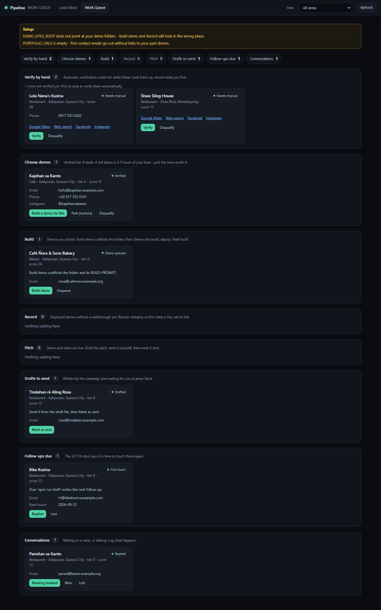

# Local Lead-Gen Pipeline

A lead-generation tool for my freelance web-development work. It finds small
businesses in Metro Manila that have **no website**, verifies that each one is
real and still open, enriches it with contact handles, and drafts first-touch
outreach. Everything lands in one **Work Queue** that shows what each lead is
waiting on.

**The rule it is built around: machines prepare, a person crafts.** The pipeline
automates finding, verifying, drafting, scheduling and bookkeeping. Choosing who
gets a demo, building it, and pressing Send stay with a person. Nothing is
ever sent or deployed automatically.



*Screenshots use seeded demo data, not real leads.*

**In production use:** the lead database (a Google Sheet) holds **4,000+
sourced businesses** across Metro Manila areas.

## Architecture

```
 Draw an area on the map (console)
          │
          ▼
 ┌─ SOURCE ───────────┐   OpenStreetMap Overpass API (retries + mirror failover)
 │ every business in  │   → SME filter: drops chains (chain index built from OSM)
 │ the area           │     and out-of-scope categories
 └────────┬───────────┘
          ▼
 ┌─ VERIFY ───────────┐   Google Maps in headless Chromium (Playwright)
 │ real? open? site?  │   → website classifier: none / social-only / real site
 │                    │   → scoring + tiers (A = demo-worthy, B = template outreach)
 └────────┬───────────┘   → unsure cases go to "Verify by hand", never guessed
          ▼
 ┌─ ENRICH ───────────┐   the business's own Facebook / Instagram page,
 │ contact handles    │   then Bing web search (other engines CAPTCHA-blocked,
 └────────┬───────────┘   which this pipeline deliberately does not bypass)
          ▼
 ┌─ DRAFT ────────────┐   tiered email / DM templates, mandatory opt-out line,
 │ outreach           │   3 / 7 / 14-day follow-up cadence, Gmail API drafts
 └────────┬───────────┘   (drafts only: a person presses Send)
          ▼
 ┌─ STORE ────────────┐   Google Sheets API (service account): the lead database
 │ one row per lead   │   + Apps Script daily follow-up digest
 └────────┬───────────┘
          ▼
 ┌─ WORK QUEUE ───────┐   local web console grouping every lead by next action:
 │ verify · demo ·    │   verify by hand → choose demo → build → record →
 │ pitch · follow up  │   pitch → follow up → won / lost
 └────────────────────┘
          │
          └─▶ for a chosen lead: Gemini Vision curates and captions the
              business's public Instagram photos into a demo-site content pack
```

Leads the machine can't settle with confidence go to **"Verify by hand"**
instead of being guessed.

## Data quality and safety

- **One rulebook for status changes** (`src/transitions.ts`). A lead can only
  move along legal paths, and an opted-out lead can never be moved toward
  contact (RA 10173, the Philippine Data Privacy Act).
- **The Google Sheet header is checked** by position before every write.
- **Retries, mirror failover and pacing** on every external call. Google Maps
  lookups are paced 12 s apart.
- **The console refuses DNS-rebinding and cross-site requests**, so other
  pages in the browser can't read lead data.
- **446 automated tests** (`node:test`), a strict TypeScript typecheck, and
  Playwright end-to-end tests for the console.

## Stack

TypeScript · Node.js · OpenStreetMap Overpass API · Playwright · Bing search ·
Google Sheets API (service account) · Gmail API · Google Apps Script ·
Gemini Vision · Zod · `node:test`

## Run it

```bash
npm install
npm test            # 446 tests, no network needed
npm run console     # Work Queue at http://localhost:3008/queue
```

A live campaign needs a free Gemini key and a Google Sheet. See
[SETUP.md](SETUP.md). For how it's built, see
[docs/ARCHITECTURE.md](docs/ARCHITECTURE.md), and for the daily loop see
[docs/WORKFLOW.md](docs/WORKFLOW.md).

## Built with

Built with AI-assisted development (Claude Code): I designed it, set the rules,
reviewed the output and tested it, and the AI wrote much of the code under that
review. [BUGS.md](BUGS.md) logs the real defects found along the way and their
root causes.

Business data © OpenStreetMap contributors, ODbL 1.0. Real lead data is kept in
a private Google Sheet and is not part of this repository.
